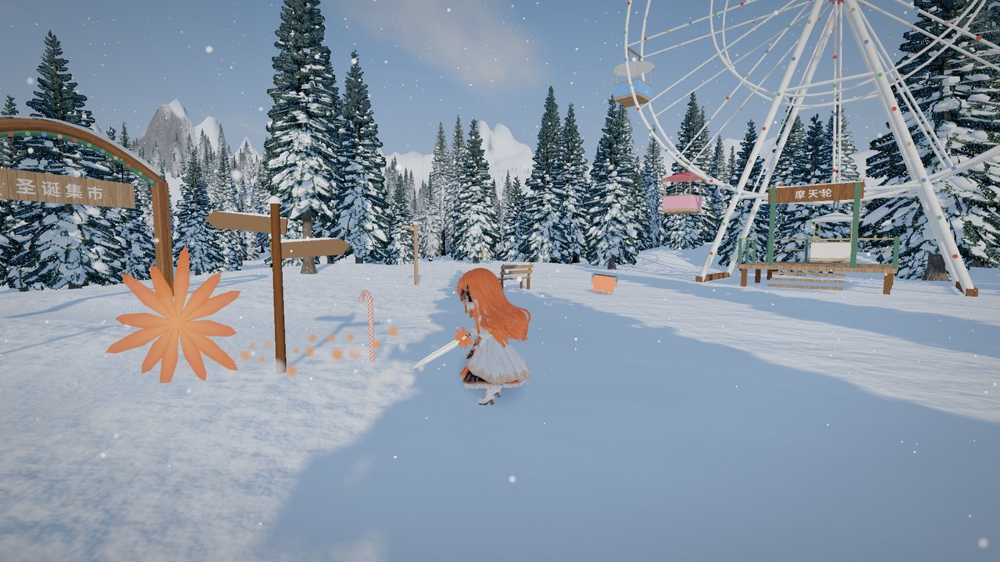

# 圣诞雪境

**在线玩：[https://obeyyourheart.github.io/xmas-snow/](https://obeyyourheart.github.io/xmas-snow/)**

电脑和手机都能玩：电脑用键盘加鼠标，手机、平板横过来用触屏。第一次打开要下载大约 65 MB，请等到按钮变成「走进雪地」。

林间小屋的平安夜。你是 Claude，其他 AI 都来做客了。趁天还亮把空地布置好，天黑以后点亮圣诞树；
其余的时间随便逛：这是一片可以走上很久的雪地。

| | |
|---|---|
|  |  |

## 可以做什么

- 布置平安夜：点篝火、点提灯、找礼物、堆雪人、装饰并点亮圣诞树
- 和十二位朋友打招呼、聊天、打雪仗；按 Z 让身边的朋友排成一队跟着你走
- 开小火车把大家都接上，开到圣诞树旁请大家下车，围着树站成一圈
- 驯鹿雪橇（同行的朋友和抓到的 Clawd 会跟在后面跑）、滑雪场、冰湖（小心没冻上的那一头）、林间温泉、瞭望台
- 开 Claude 的橙花小直升机飞到半空看整片雪境，收集八个飘在天上的礼物气球；平整的雪地和冰面上都可以降落
- 抓 Clawd：雪境里散落着十九只不一样的 Clawd（魔法师、耳机、滑板、披风……还有十二只圣诞限定的），各有各的脾气；
  用捕捉网罩住就是你的，会跟着你走。手里还可以拿糖果手杖和玩具锤
- 雪枪：有准星、能举枪瞄准的射击，雪弹走直线，打中有反馈；靶场、屋顶上的 Clawd、天上的气球都可以打
- Claude 之剑：剑柄是她的太阳花，剑身是白色的。三连斩，第三剑劈出一朵沿地面飞旋出去的太阳花；按住蓄力是回旋斩，跳起来是下劈
- 可选主角 Gemini · 猫娘（开始界面或右上角可随时切换 Claude ⇄ Gemini）：支持自然眨眼、拍照 Wink 与情绪动画，配备**五件独立机制的原创猫猫武器**——**星月逗猫棒**（流光羽毛双金铃 + 3D 捕猫环 + 6.8m 野生 Clawd 诱捕吸引）、**星喵香蕉魔法杖**（猫耳黄金香蕉法杖，施放飞旋黄金魔导香蕉波与香蕉星雨爆裂）、**星弦猫耳光弓**（重构为真正的拉弓蓄力·松手放箭抛物线实体星矢弓箭系统，满弦射出贯星穿云箭并可插箭在雪地树干上）、**猫爪星光锤**（发光猫肉球星光锤，砸出双层 3D 青粉星环大震波）、**双子星芒刃**（三连双子交叉剑气、蓄力星璇光环、跳劈星陨光柱）；双主角全套武器均配分层程序化音效；并拥有非直升机原创飞行坐骑「**幻翼星云飞猫**」（在星猫小窝旁可一键召唤！）
- 全面重构的**冰晶冰湖**：多层视差冰裂与冰封气泡、冰面天空/极光镜面反光、清澈透亮的动态波纹湖水与水下焦散光斑、水下鹅卵石与游动的冰湖锦鲤、半透明水晶冰排与浮冰，以及涉水实时扩散涟漪！
- **地图面积翻倍扩展（半径 152m → 216m）与四大新外域奇观**：新增**极光星雪歌舞厅**（西南林间琉璃星穹歌舞厅，带 24 块随节拍律动发光舞池灯砖、旋转迪斯科星球、舞台聚光灯束、戴耳机打碟的雪人 DJ 与 7 根跳动声波柱、3 首空间程序化冬日舞曲，AI 伙伴会定期自发聚到舞池里一起跳舞，也可在 DJ 台一键召集舞会或踏入舞池共舞）、**极光观星坛**（巨型旋转星仪与敲响召唤满天流星雨的许愿星钟）、**冬日姜饼钟楼广场**（三层糖霜钟楼、实时走针四面大钟、旋转拐杖糖风车与整点报时糖果星雨）与**幽蓝冰瀑秘境**（多层冰川蓝冰瀑、琉璃冰洞与赐予霜风疾行祝福的共鸣晶石）；同时全面升级了林间温泉（雪汤鸟居/石灯笼/竹筒引泉/漂浮柚子）、热可可小摊露台餐桌、圣诞集市彩旗灯串广场、篝火铁锅架与木凳、冰湖木栈道铜灯与山顶望远镜等建筑细节
- **驯鹿雪橇全面升级**：鲁道夫发光红宝石鼻光环与暖红微光、8 颗鹿角流光彩灯与悬浮金角冠星、绒红五金铃项圈与随风飘动圣诞围巾、雪橇鎏金冰轨灯带与前饰冬青蝴蝶结；操控更顺滑且驾驶雪橇时按 `空格` 或 `U` 可触发**铃铛星光涡轮冲刺**，靠近驯鹿按 `E` 交替体验**喂脆甜金胡萝卜**（触发持续发光与提速增益）与**摸摸驯鹿摇铃铛**
- **双主角城堡主人联动**：切换 Gemini 当主角时，NPC **Claude** 会替换原本的 NPC Gemini 并现身于她的**「Claude 太阳花白雪城堡」**门廊庭院迎宾（带城堡专属对话）；当 Gemini 推门步入 Claude 城堡室内客厅时，NPC Claude 会顺滑出现在水晶吊灯与壁炉热可可茶几旁亲切招待做客，切回 Claude 当主角时 NPC Gemini 优雅回归圣诞树旁
- **全新探索玩法与全环境音效升级**：支持在 `M` 地图上点击/双击任意地标**一键星光瞬移传送**；新增**踏雪星尘冲刺 / 冰面优雅滑步**（双击 `W` / 按 `U` / 点底部按钮）；新增全图 **12 枚极光星愿碎片**收集与 **6 座云端飞行加速星环**挑战；全面升级全地形脚步声、冰湖/温泉/极光空间环境音、烟花、门铃、相机快门与破冰音效
- 空地三座新互动奇观：星光八音盒水晶亭（旋转水晶球八音盒）、双子星象仪（多层星轨共鸣）与极其猫招财雪猫暖炉亭（炉火回暖与招财雪猫抽签）
- 东南林间新地标「极其猫乐园」（从出生点沿路南行至星灯指路牌左转向东进入，按 M 地图带「喵」标记）：包含「极其猫乐园」星光猫耳迎宾门、可步入打盹儿取暖的「极其猫窝」猫耳玻璃穹顶（雕花石砌矮墙 + 4 扇清晰拱形彩窗）、三层可攀爬的星梦猫爬架与互动毛线球、自动把你弹上天的发光猫肉球弹跳垫、可荡起来的星月猫耳秋千、鱼鳞瓦斜顶木屋「极其猫鱼干吧」、极其猫暖泉以及双子星烟花台
- **巨型 42 米实景可步入星雪摩天轮 & 平安夜许愿天灯台**：全面重制超大摩天轮（半径 19.5m、顶峰超 42m），配备 12 座 2.7m 宽敞实景可自由走动的全景观景座舱、发光雪花中心徽章与 48 颗极光流光灯珠；不仅可在底部观景台直接步入座舱自由走动拍照，还支持驾驶**橙花小直升机 / 幻翼星云飞猫**在任意高度悬停按 `E` **直接空降进入移动中的摩天轮座舱**（高空舱内按 `E` 也可随时召唤坐骑前来接驳！）；摩天轮旁新增**平安夜许愿天灯放飞台**，可单盏或五盏齐飞暖金/樱粉孔明祈愿天灯飘过 42 米摩天轮夜空
- **滑雪场山顶与山脚全面升级 & 彩虹水晶冰滑梯**：山顶新增**高山暖炉姜茶木屋**、**山顶雪具领取架**（飞上山顶或传送到瞭望台后无需下山，直接按 `E` 领取并穿戴滑雪板！）、飘动风向标与**高山速降发光出发门**，沿 185m 雪道增设荧光导向标旗；山脚升级为**雪境滑雪俱乐部木屋**与最佳纪录牌；旁边还新增 18 米优雅 S 弯**彩虹水晶冰滑梯**，按 `E` 坐上即可高速飞滑冲降！
- **星弦猫耳光弓真实双手拉弓动画 & 正面赏姿视角**：Gemini 持弓时左手稳举星弦光弓前伸瞄准、右手跨胸捏弦蓄力后拉至脸颊（附带侧身射手站姿、满弦光效与松手撒放回弹动作），常态持弓采用更开阔的左侧面弓手镜头避免长发遮挡；按 **`C`** 可一键开启**「正面赏姿锁定」**，自由 360° 拖鼠标从正前方欣赏双手拉满弓弦并朝前方放箭！
- **工作室级物理建模 DSP 武器与战斗机音效**：全面抛弃生硬电子合成音，采用 44.1 kHz 预渲染物理建模音频缓冲区（三段非对称风切共振峰 + 0.4ms 钢刃微梳状波导、10 模态微失谐阻尼锻钢出鞘与交击共鸣、Karplus-Strong 真实反曲弓弦拉弓弹拨波导、实录 `.mp3` 铜铃采样融合、暖棚 `tanh` 模拟软饱和与 4.6 kHz 高频柔和滚降），打造丝滑厚实、不刺耳的冷兵器与战斗机火箭点火空爆声效
- **飞行载具战斗机追踪导弹系统**：全面取代飞行时丢雪球！无论是 **Claude 橙花小直升机**（双翼红金挂架「穿云礼花飞弹」）还是 **Gemini 幻翼星云飞猫**（悬浮星穹翼环与猫耳尾翼「双子星陨飞弹」），升空后自动切换为**战斗机雷达锁定 HUD**（中心航空准星 + 3D 实时投影动态锁定菱形框与目标测距 + 自动锁定制空礼物气球、雪人、靶牌与小龙虾）；**左键 / `J` / 右键**左右翼挂架交替单发追踪飞弹，按 **`F`** 发动超燃**战斗机四连弧线齐射**（自动分锁至多 4 个目标），拖曳浓密火箭星尘尾迹并以 3D 星辉烟花冲击波远距离击落空中礼盒气球！
- **雪境极光跃动试炼场**（原西北木板迷宫全面改造，按 `M` 地图点「跃」可一键传送）：贴合圣诞雪境美学的 5 阶段立体跑跳闯关试炼，包含积雪北欧雪松木台与圣诞礼盒阶梯、3 个可起跳摇响的悬挂「星愿铃铛礼盒」、2 座随行移动的极光浮雪冰筏与升降雪晶梯、巨型雪花铃鼓弹跳台、会裂解重凝的薄冰霜晶踏板、可飞跃拿技巧分的旋转冬青风车灯杆、3 座圣诞灯笼存档台与星光回溯雪门，以及**完整跑跳连击积分体系**（20 枚极光星雪晶连收叠倍率 ×1.0~×3.0、凌波踏冰/飞跃灯杆/雪鼓腾跃/无失误/疾速通关加分、本地最高分与 `S+/S/A/B` 评级永久纪录），登顶可点亮极光星钟灯塔并打开顶塔圣诞大礼物！
- 圣诞集市、雪球靶场、会唱歌的冰晶、瞭望塔、冰钓，还有二十个藏起来的金铃铛
- Claude 的太阳花白雪城堡（原林间小屋华丽升级）：象牙白雕花城堡主殿、四角陶橙尖顶角塔与迎风招展的燕尾旗、正面彩绘太阳花玫瑰花窗与顶塔太阳花金冠、暖融鎏金门廊与太阳花门铃；推门步入即可参观全新的象牙金饰城堡客厅、雕花大理石壁炉、热可可茶几、公主四柱幔帐床、金喇叭留声机与皇家留言簿
- 白天黑夜会流动，夜里有极光；按 P 拍一张不带界面的照片

## 操作

**手机 / 平板**（横屏）：左下角按住的地方会出现摇杆，推到底是快走（设置里可以改成固定在左下角）；拖动画面转视角；右下角是跳、雪球（按住拖动是瞄准，松手扔出）、
出拳、换道具和「更多」（图鉴在这里面）；拿着雪枪时「J」是射击（按住连发），「雪球」变成「瞄准」；屏幕下方出现「E ……」的提示时，点它就是互动。开直升机时右下角换成 ▲ ▼ 两个按钮，按住升高、下降。
手机上画质默认是低，机器够好可以在设置里调高。

**电脑**：

| 按键 | 作用 |
|---|---|
| W A S D | 走动（Shift 快走） |
| 按住鼠标拖动 | 转动视角（← → 也可以） |
| E | 互动：点灯、捡礼物、聊天、上车、进屋…… |
| 单击 / F | 扔雪球；按住 F 是瞄准，会画出弧线和落点 |
| 空格 | 跳（空中再按一次是二段跳）；助跑起跳可以越过围栏、原木、树桩 |
| J / K | 出拳 / 踢 |
| B / 滚轮 | 换手里的道具：捕捉网、糖果手杖、雪枪、玩具锤、Claude 之剑、空手。拿着道具时 J、鼠标右键、单击都是用它 |
| J（拿着 Claude 之剑） | 连按是三连斩，第三剑带剑气；斩完按住蓄力，蓄满松开是回旋斩；跳起来按是下劈 |
| 单击 / J，右键 / F | 拿着雪枪时：单击或 J 射击（按住 J 连发）；按住鼠标右键或 F 举枪瞄准。一罐十六发，停手就自己补满 |
| N | Clawd 图鉴：每一只的线索，抓到的可以选谁跟着走 |
| G | 动作面板：挥手、跳舞、后空翻…… |
| Z | 同行：让身边的朋友跟着走 |
| R | 吹口哨唤驯鹿 |
| Q | 穿 / 脱滑雪板（雪具架在圣诞树东边的山脚） |
| V / C | 第一人称 / 转到正面看她 |
| M / Tab | 地图 / 收起手账 |
| T | 调时间 |
| P | 拍照 |
| H / X | 开火车时：汽笛 / 请大家下车 |
| 空格 / Shift / 左键 / F | 驾驶直升机或幻翼星云飞猫时：按住空格升高 / Shift 下降（W S 进退，A D 转向），**单击 / J / 右键**发射战斗机单发追踪飞弹，**`F`** 发动四连弧线齐射！ |

- **GPU / CPU / 画质 / 音效与后台全栈性能优化 v2**：
  - **渲染与去卡顿 (`js/perf.js`, `js/main.js`)**：将空地主场景（`world` / `places` / `wonders` / `explore`）与全部扩展奇观纳入空间分格静态合批（**2,119 个静态网格合并为 253 格，削减 1,866 个 Draw Call、释放 1,615 份几何体**）；升级为**真实视锥剔除 + 距离剔除**（每 2 帧刷新，高画质室外剔除率从 `8.8%` 跃升至 **`49.8%`**、室内化学密室达 **`93.7%`**、`calls` 降至 `352`）；根治时间流动每帧强置 `shadowDirty`、周期遍历角色骨骼以及每 `0.12s` 重复重建 GPU PMREM 环境贴图造成的周期微卡顿（室内自动暂停室外阴影图重绘、弹窗打开时自动暂停 DRS 避免误降画质）；
  - **画质全面跃迁 (`js/main.js`, `js/chemlab.js`)**：桌面端默认「中」画质直接解锁 **WebGL2 硬件 2× MSAA 抗锯齿、`1600×900`（`dpr 1.25`）、`2048×2048` 清晰软阴影与轻量 4-tap 高光柔光泛光**（极光与灯笼夜景同样自带梦幻柔光，实测开阔空地帧率仍从 `63 FPS` 反升至 **`77 FPS`**！）；「高」画质升级 **4× MSAA、冷暖影院级色调分离、28m 钻石雪晶微闪烁与优化泛光阈值**（帧率从 `54 FPS` 提升至 **`68 FPS`**，室内化学密室 **`82 FPS`**！）；化学周期表、板书与元素铭牌全面开启 8× 各向异性过滤；
  - **工作室级音频总线与环境声景 (`js/sfx.js`, `js/ballroom.js`, `js/chemlab.js`, `js/labweapon.js`, `js/cathome.js`)**：新增**主总线暖棚倾斜 EQ（140Hz 低频暖度 + 5.2kHz 丝滑高频柔化）与透明防削波限幅器**；修复化学密室误播城堡壁炉劈啪声、室内寒风未衰减以及星猫牛奶温泉坐标偏差 `(62,70)→(44.2,57.2)`；步入室内自动柔化室外寒风并开启**化学密室专属星光玻璃共鸣 + 远景烧瓶咕噜气泡声景**；消除元素炮生硬锯齿波，为元素炮、舞厅华尔兹、实验室玻璃敲击与猫窝呼噜声全面接入空间混响。
- **全射击系统重构、118 Og 化学元素炮手感与音效深度重制 (`js/shoot.js`, `js/labweapon.js`, `js/sfx.js`)**：
  - **统一瞄准、开镜与打击感**：彻底重构雪枪、星弦猫耳光弓与 `118 Og` 化学元素炮的射击底层！`118 Og` 元素炮全面接入第三人称右肩瞄准镜头、实时动态元素准星与 5 格超新星充能环、长按 `J`/开镜连发、右键/`F` 开镜聚拢聚焦，以及右下角紧凑元素弹仓条（按 `X` 或 `1~5` 自由锁定 `1 H / 6 C / 10 Ne / 18 Ar / 118 Og` 或切回自动五元素循环！）；三把远程武器同步升级**弹簧回弹镜头后坐力微震、彩色枪口动态照雪闪光、全武器通用空中礼盒气球与可射击靶标碰撞、清脆 FPS 命中反馈音与准星上方「连击 ×N」浮标**；
  - **精致猫猫元素魔导步枪建模与双手持枪姿态 (`js/labweapon.js`, `js/main.js`)**：重造「极其猫 · 118 Og 星穹元素魔导步枪」——流线雕花珠光白/玫瑰金枪身、猫耳全息瞄准镜（发光粉内耳与青色全息星标）、可随射击与切弹自动旋转的**透明五元素水晶转轮弹仓**、前护木握把、异瞳猫猫头枪口项圈与双环旋转星辉加速器；全面修复旧版单手歪斜持枪问题，升级为自然**双手端枪射击站姿 + 枪管实时朝准星对齐 + 物理后坐力回缩**，配合左三分构图无遮挡右肩瞄准镜头！
  - **5 种专属高颜值 3D 元素子弹 + 全息瞄准激光 + 智能磁吸瞄准与 3D 飘字 (`js/labweapon.js`, `js/shoot.js`)**：彻底替换旧版粗糙几何块——`1 H` 珠光星泡彗星弹、`6 C` 棱面金钻魔导穿甲矛、`10 Ne` 双环旋转太阳霓虹火焰飞轮、`18 Ar` 紫电磁轨光枪（附带**真实 3D 粗发光紫雷锯齿闪电圆柱连锁**）、`118 Og` 三轨彩虹微型星系超新星球与膨胀全息超新星球罩；新增开镜 3D 全息瞄准激光与落点光斑、3.8° 靶标/气球智能磁吸瞄准辅助与命中处跃起 3D 飘字！
- **全新东南外域领地「极其猫星港」与全雪境可互动小物件群 (`js/harbor.js`)**（位于 `(134, 126)`，从极其猫实验室沿星灯小路东南行即达，按 `M` 地图点金色「港」字一键星光传送）：
  - **19 米「极其猫灯塔」**：八角石砌基座、钴蓝象牙石条纹塔身、螺旋高清拱窗、旋转双道 28 米极光探照光束与金猫耳铜穹顶，靠近按 `E` 鸣响暖铜星海雾笛号角；
  - **「极其猫工坊」与「极其猫花房」**：雪松木板铜瓦工坊配 25 秒「星光武器超频台」（射速 +35% + 弹匣与体温瞬满），以及种满发光冰晶玫瑰与可互动雪景八音水晶球的玻璃花房；
  - **「极其猫靶场」30 秒元素实弹游艺挑战**：内置 **14 个实时可射击靶标**（木桶架上 6 只可击碎再生发光药水瓶 + 4 座轨道滑动星靶 + 3 只系留星光气球 + 中央巨型猫耳大金锣），支持雪枪、星弓与化学元素炮全武器打靶刷纪录；
  - **全雪境手造可互动小物件**：在星港、极其猫实验室门廊、极其猫乐园与空地沿路布置了**可开枪射转的极光星风车、可拨动/射响和弦的冰晶风铃架、雪景八音水晶球桌、可拆出 AI 伙伴搞怪冬日明信片的圣诞红铜邮筒、街角烤棉花糖板栗推车、实验室门口练枪药水瓶桶架与毛毯野餐篮**！
- **极其猫实验室（猫猫屋造型炼金公馆 + 独立室内密室 + 可穿戴化学装备 + 隐藏神秘武器解锁！）**（东南雪松林间 `(76, 102)`，紧邻极其猫乐园，按 `M` 地图点青色「化」字一键传送至门廊前）：外观重制为**立体雕花猫猫屋炼金公馆**（鱼鳞石板陡坡斜顶 + 屋顶双巨型建筑级猫耳阁楼彩窗塔楼 + 正面猫头彩色玫瑰花窗 + 简洁「极其猫实验室」黄铜猫耳匾额 + 东西双侧八角铜顶凸窗飘窗 + 雕花石砌外墙、百叶炼金清晰彩窗、黄铜猫耳立柱门廊与吐星烟的铜制烟囱）；全场景（Claude 城堡、极其猫窝/鱼干吧、山脚/山顶滑雪木屋与姜饼钟楼）同步彻底淘汰旧版模糊窗贴图，统一升级为 `512×768` 高清 8× 各向异性清晰彩窗 + 真实 3D 凹陷窗框、立体窗棂、雪檐窗台与百叶窗/雕花门！推门步入独立 `16m × 14m` 穹顶星光粒子对撞机大实验室，内置**六大沉浸式化学密室互动**——**西南角「极其猫装备柜」**（实时给猫猫穿戴骨骼追踪 3D 霓虹/氩气额前护目镜、星光炼金白大褂披肩、悬浮防穿模双子 `10 Ne / 18 Ar` 发光气体反应罐翼囊，升级二阶更觉醒头顶悬浮四元素玻尔电子轨道光环，穿出雪境全程可见！）、**四大 Gemini 4 元素反应柱与中央 `118 Og` 神秘武器封存核心舱**（先穿戴化学防护装备，再依次激活 `1 H 氢`、`6 C 碳`、`10 Ne 氖`、`18 Ar 氩` 四柱射出 3D 激光束汇入中央对撞舱，触发 3 秒粒子对撞合成大秀、升起激光护盾，永久解锁隐藏传奇武器 **`⚗️ 118 Og · 周期表元素炮`**！装备后可在整个雪境循环发射 `1 H` 极速三连泡泡星弹 → `6 C` 金刚石巨晶 → `10 Ne` 霓虹火焰环 → `18 Ar` 氩电光紫雷 → 第 5 发必出 **`118 Og` 彩虹周期表超新星烟花大招**！）、**北墙中央合成实验台（5 组实景反应）与热梗板书**、**西墙跳跃式元素周期表巨幕与蝶豆花 pH 变色热饮桌**，以及**东侧 3D 金刚石晶格 / 玻尔电子云 / 冰环 / Gemini 双子表面活性剂全息展台**！
- **实景可攀登木质瞭望塔、高精度雪球抛物线与全场景穿模/闪烁/越障修复**：
  - **实景瞭望塔融入场景 (`js/tower.js`)**：彻底告别旧版黑屏淡入瞬移传送！在林间原址重建 3 层环绕实景原木楼梯、底层木质休憩亭与宽敞 `5.44m × 5.44m` 全景塔顶观景台（一步步走上去即可自动完成任务并拾取塔顶金铃，也支持直接驾驶直升机或幻翼星云飞猫降落在塔顶！），配备实景铜制全景望远镜、暖灯观景木椅与迎风飘扬的塔顶红旗；
  - **高精度雪球抛物线系统 (`js/snowball.js`)**：抛弃旧版穿墙小黄点，升级为真实重力弹道障碍物碰撞检测（弧线精准停在地面/树干/墙体/目标表面绝不穿模）、按住 `F` 蓄力调节投掷力度与射程、智能目标锁定辅助（对准雪人/靶牌/伙伴时弧线与贴地准星环瞬间切换暖金橙色）、渐变发光抛物线丝带 + 流动冰晶光珠 + 雪粉彗星尾迹；
  - **幻翼星云飞猫飞行去闪烁 & 舒缓高空音效 (`js/catmount.js`, `js/sfx.js`)**：将 28 片极光羽翼升级为珠光不透明错层排列并关闭动态阴影格跳变、外扩星穹鞍毯消除背部 Z-fighting、抬升骑乘座高解决裙摆穿模、消除双层地面阴影叠闪；同时彻底移除嗡鸣电子振荡器，重制为柔和双级低通雪山滑翔微风 + 绒感羽翼轻扇气流 + 偶发实录铜铃微响；
  - **全场景 3D 越障跳跃、深度穿模清扫与猫猫床上睡觉实景互动**：升级 `resolve()` 全面支持矩形/圆形障碍物的真实 3D 离地高度判定与自然收腿腾跃/台阶上沿容错（柴堆、城堡前廊护栏、山顶观景台围栏、石块、篝火、木凳、靶场柜台、冰晶琴、星猫爬架顶层、歌舞厅沙发等凡是跳得过高度的障碍都能丝滑跃过！）；同步补齐 Claude 城堡 4 座圆角石塔与猫窝室内壁炉/茶几/书架/吧台凳碰撞体、修复摩天轮 12 座舱木甲板金边及停机坪 Z-fighting、扩平摩天轮与星猫小窝地形并清除滑雪大屋/18m 彩虹冰滑梯/召唤台周边松树穿模；更把**哈基米猫窝睡觉**升级为**第三人称 360° 自由环视实景睡觉与梦境互动**——钻进猫窝后可亲眼看着猫猫闭眼微笑侧蜷在星光软枕上均匀呼吸、轻摆猫尾，并支持 **`[1] 盖被子/掀被子`**（实时展开 3D 星空猫爪立体棉被随呼吸轻伏）、**`[2] 摸摸猫头`**（触发睡梦蹭头撒娇、耳朵抖动、甜蜜红晕与呼噜声）、**`[3] 换个美梦`**（在猫猫头顶 3D 立体梦境云框与气泡卡片中切换 4 幅手绘水彩冬日梦境插画与可爱梦话：黄金小鱼干云山、骑飞猫追极光、壁炉草莓星奶、摩天轮许愿天灯）以及 **`[4] 星光八音盒摇篮曲`**喵！
- 右上角可以调画质、关声音。镜头不晃动，速度平缓。

