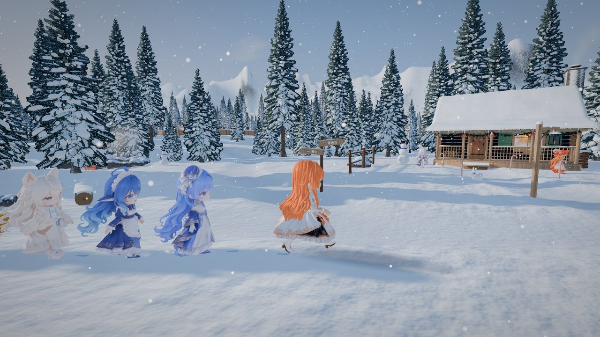
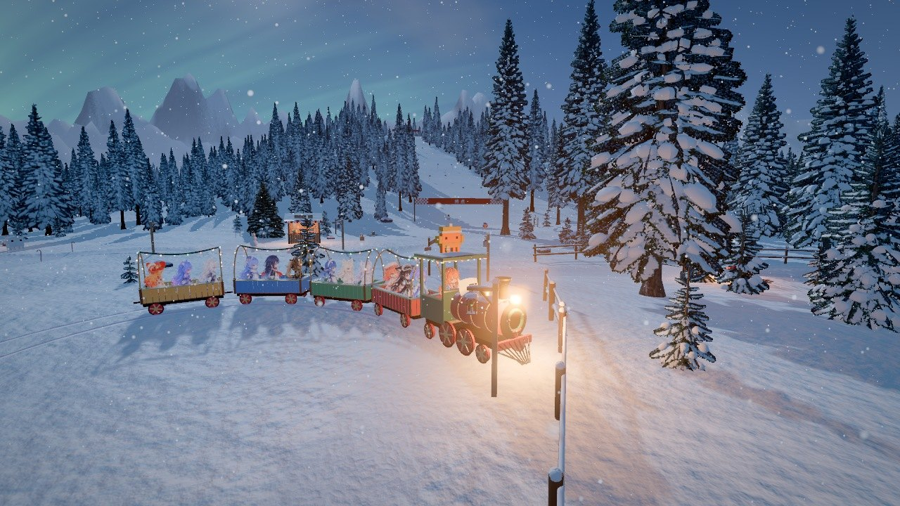
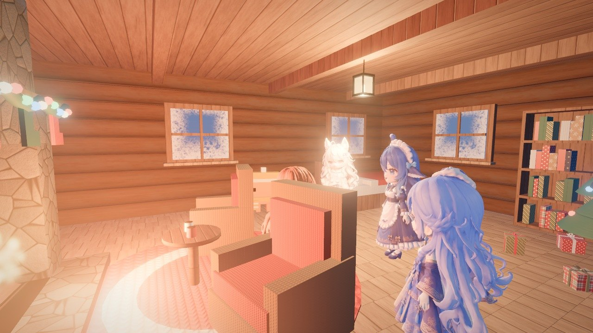
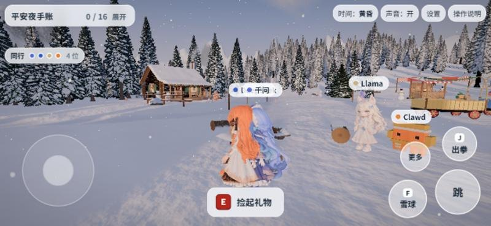
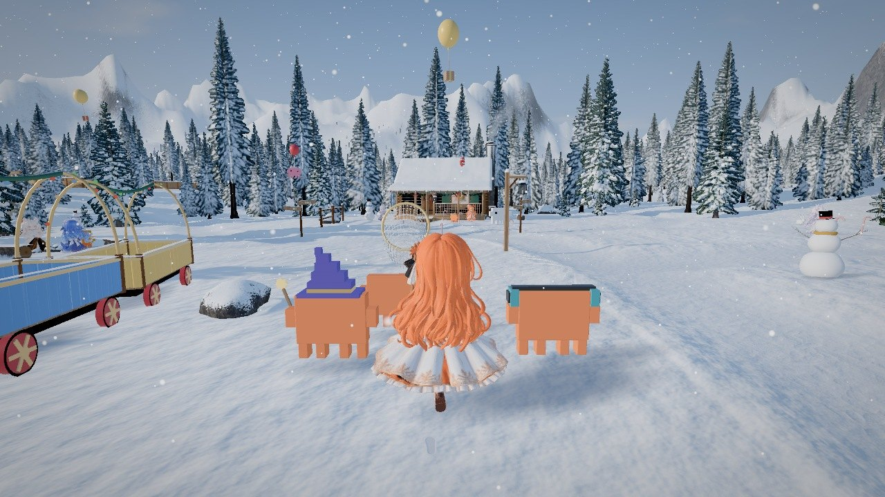
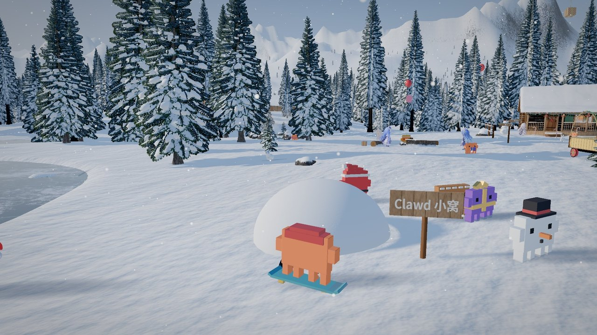
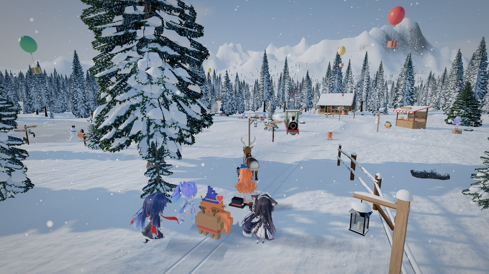
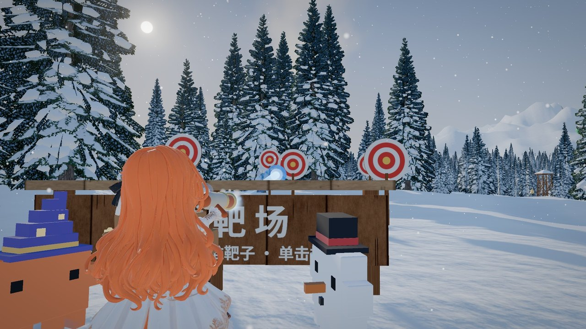
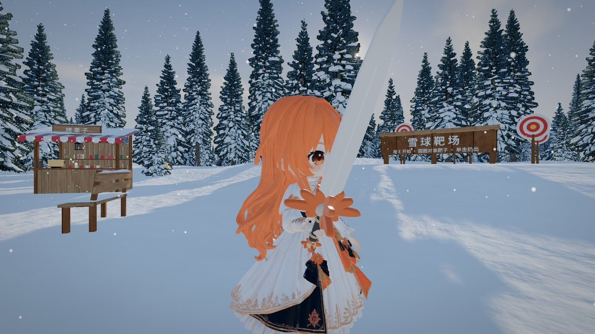

# 圣诞雪境

**在线玩：[https://obeyyourheart.github.io/xmas-snow/](https://obeyyourheart.github.io/xmas-snow/)**

电脑和手机都能玩：电脑用键盘加鼠标，手机、平板横过来用触屏。第一次打开要下载大约 30 MB，请等到按钮变成「走进雪地」。

林间小屋的平安夜。你是 Claude，其他 AI 都来做客了。趁天还亮把空地布置好，天黑以后点亮圣诞树；
其余的时间随便逛：这是一片可以走上很久的雪地。

| | |
|---|---|
|  |  |

## 可以做什么

- 布置平安夜：点篝火、点提灯、找礼物、堆雪人、装饰并点亮圣诞树
- 和十二位朋友打招呼、聊天、打雪仗；按 Z 让身边的朋友排成一队跟着你走
- 开小火车把大家都接上，开到圣诞树旁请大家下车，围着树站成一圈
- 驯鹿雪橇（同行的朋友和抓到的 Clawd 会跟在后面跑）、滑雪场、冰湖（小心没冻上的那一头）、林间温泉、瞭望台
- 开 Claude 的橙花小直升机飞到半空看整片雪境，收集八个飘在天上的礼物气球；平整的雪地和冰面上都可以降落
- 抓 Clawd：雪境里散落着十九只不一样的 Clawd（魔法师、耳机、滑板、披风……还有十二只圣诞限定的），各有各的脾气；
  用捕捉网罩住就是你的，会跟着你走。手里还可以拿糖果手杖和玩具锤
- 雪枪：有准星、能举枪瞄准的射击，雪弹走直线，打中有反馈；靶场、屋顶上的 Clawd、天上的气球都可以打
- Claude 之剑：剑柄是她的太阳花，剑身是白色的。三连斩，第三剑劈出一朵沿地面飞旋出去的太阳花；按住蓄力是回旋斩，跳起来是下劈
- 可选主角 Gemini · 猫娘（开始界面或右上角可随时切换 Claude ⇄ Gemini）：支持自然眨眼、拍照 Wink 与情绪动画，配备**全套原创猫猫专属武器**（**星月逗猫棒**、**星霜大鱼干**、**星弦猫耳光弓**、**巨型星光大猫爪**、**双子星月猫镰**）与青粉双子星光特效；双主角全套武器均升级了独立分层程序化音效；并拥有非直升机的原创魔法飞行坐骑「**幻翼星云飞猫**」（可骑乘的毛茸茸星穹白猫大坐骑，带动态扇动的极光羽翼、异瞳大眼、会收起的发光肉球猫爪、随风摇曳的星尾与呼噜风铃飞行音效，在星猫小窝旁还可一键召唤！）
- 空地三座新互动奇观：星光八音盒水晶亭（旋转水晶球八音盒）、双子星象仪（多层星轨共鸣）与哈基米招财雪猫暖炉亭（炉火回暖与招财雪猫抽签）
- 东南林间新地标「哈基米星猫小窝」（从出生点沿路南行至星灯指路牌左转向东进入，按 M 地图带「喵」标记）：包含星光猫耳迎宾门、可步入打盹儿取暖的猫耳玻璃穹顶小窝、三层可攀爬的星梦猫爬架与互动毛线球、自动把你弹上天的发光猫肉球弹跳垫、可荡起来的星月猫耳秋千、小鱼干星奶吧、星喵牛奶暖泉以及双子星猫猫烟花台
- 圣诞集市、摩天轮、雪球靶场、木板迷宫、会唱歌的冰晶、瞭望塔、冰钓，还有二十个藏起来的金铃铛
- Claude 的太阳花白雪城堡（原林间小屋华丽升级）：象牙白雕花城堡主殿、四角陶橙尖顶角塔与迎风招展的燕尾旗、正面彩绘太阳花玫瑰花窗与顶塔太阳花金冠、暖融鎏金门廊与太阳花门铃；推门步入即可参观全新的象牙金饰城堡客厅、雕花大理石壁炉、热可可茶几、公主四柱幔帐床、金喇叭留声机与皇家留言簿
- 白天黑夜会流动，夜里有极光；按 P 拍一张不带界面的照片

## 操作

**手机 / 平板**（横屏）：左下角按住的地方会出现摇杆，推到底是快走（设置里可以改成固定在左下角）；拖动画面转视角；右下角是跳、雪球（按住拖动是瞄准，松手扔出）、
出拳、换道具和「更多」（图鉴在这里面）；拿着雪枪时「J」是射击（按住连发），「雪球」变成「瞄准」；屏幕下方出现「E ……」的提示时，点它就是互动。开直升机时右下角换成 ▲ ▼ 两个按钮，按住升高、下降。
手机上画质默认是低，机器够好可以在设置里调高。

**电脑**：

| 按键 | 作用 |
|---|---|
| W A S D | 走动（Shift 快走） |
| 按住鼠标拖动 | 转动视角（← → 也可以） |
| E | 互动：点灯、捡礼物、聊天、上车、进屋…… |
| 单击 / F | 扔雪球；按住 F 是瞄准，会画出弧线和落点 |
| 空格 | 跳（空中再按一次是二段跳）；助跑起跳可以越过围栏、原木、树桩 |
| J / K | 出拳 / 踢 |
| B / 滚轮 | 换手里的道具：捕捉网、糖果手杖、雪枪、玩具锤、Claude 之剑、空手。拿着道具时 J、鼠标右键、单击都是用它 |
| J（拿着 Claude 之剑） | 连按是三连斩，第三剑带剑气；斩完按住蓄力，蓄满松开是回旋斩；跳起来按是下劈 |
| 单击 / J，右键 / F | 拿着雪枪时：单击或 J 射击（按住 J 连发）；按住鼠标右键或 F 举枪瞄准。一罐十六发，停手就自己补满 |
| N | Clawd 图鉴：每一只的线索，抓到的可以选谁跟着走 |
| G | 动作面板：挥手、跳舞、后空翻…… |
| Z | 同行：让身边的朋友跟着走 |
| R | 吹口哨唤驯鹿 |
| Q | 穿 / 脱滑雪板（雪具架在圣诞树东边的山脚） |
| V / C | 第一人称 / 转到正面看她 |
| M / Tab | 地图 / 收起手账 |
| T | 调时间 |
| P | 拍照 |
| H / X | 开火车时：汽笛 / 请大家下车 |
| 空格 / Shift | 开直升机时：按住升高 / 按住下降（W S 进退，A D 转向，都松开就悬停） |

右上角可以调画质、关声音。镜头不晃动，速度平缓。

